# Challenge 04：银行模型风险管理项目 SOP

> SOP = Standard Operating Procedure（标准操作流程）。本文将项目讨论整理成执行计划。开发方案是自定实现，不是额外官方要求。Challenge 04 在原活动方案中仍待 EXL 确认；日期、题目状态及提交规则须以最新通知为准。

## 1. 项目目标与验收范围

**一句话目标：上传旧 R 模型，由 Agent 整理模型档案，将一个模型移植到 Python，自动运行验证并生成供人工审核的报告。**

官方题意要求：

- 为 3–5 个示例模型建立 Documentation（文档）和 Model inventory（模型清单）。
- 将其中一个 SAS 或 R 模型重新实现为 Python，并提供 Parity proof（等价性证明）。
- 自动生成包含 Performance（性能）、Stability（稳定性）、Fairness（公平性）的验证报告。

本项目最小范围：3 个自行构建的 R 示例模型，其中 1 个完成 Python 移植；使用 Synthetic data（合成数据）。明确标注模型、数据、文档均为演示素材，不代表 EXL 或银行生产资产。

## 2. 项目核心知识与学习顺序

核心是 **Model validation（模型验证）与 Evidence（证据）管理**。必须能解释模型如何预测、迁移前后为何一致、哪些指标真实计算、哪些信息仍未知。

| 顺序 | 核心知识 | 需要掌握到什么程度 | 项目中的产物 |
| --- | --- | --- | --- |
| 1 | Logistic regression，逻辑回归 | 理解特征、系数、截距、概率和分类阈值 | 可运行的 R 基准模型 |
| 2 | Data preprocessing，数据预处理 | 处理缺失值、类别编码、字段顺序与缩放 | 固定的预处理说明与参数 |
| 3 | Parity，等价性 | 同一输入在 R/Python 中产生足够接近的概率及一致分类 | 逐记录差异报告 |
| 4 | Model validation，模型验证 | 理解训练/测试分离、ROC-AUC、混淆矩阵与概率校准 | 验证指标 JSON |
| 5 | Stability / Fairness，稳定性与公平性 | 识别分布变化，比较群体错误率并报告样本量 | 模拟变化和群体分析 |
| 6 | Model inventory，模型清单 | 记录用途、版本、变量、来源和限制，未知项不编造 | 模型档案与缺口清单 |
| 7 | Agent workflow，智能体流程 | 调用分析和测试工具，基于返回证据写文档 | 有来源和日志的自动化流程 |

不需要先掌握全部银行监管知识或复杂深度学习。先跑通一个模型的迁移与验证，再扩充模型清单。

## 3. 推荐实现结构

以下为项目实现选择，可根据团队技能调整：

- **R**：创建旧模型并输出基准预测。
- **Python**：数据生成、模型移植、指标计算、报告生成。
- **Streamlit**：搭建演示页面；这是简化原型的选择，不是官方规定。
- **pytest**：验证等价性、输入处理和失败检测。
- **LLM（大语言模型）API**：分析代码、生成文档和移植草稿；保留输入、输出与工具执行记录。
- **Git**：保存源代码、版本与测试证据。

数据流：模型代码和说明 → Agent 分析 → 结构化模型档案 → Python 移植草稿 → 执行测试 → 指标 JSON → 带来源的验证报告 → Human review（人工审核）。

### 职责边界

| 环节 | Agent 执行 | 确定性程序执行 |
| --- | --- | --- |
| Discover，发现 | 提取模型类型、输入输出和代码依据 | 文件读取、语法或结构检查 |
| Document，文档化 | 写说明，标注 Unknown（未知） | 校验档案必填字段与来源 |
| Redevelop，重新实现 | 生成 Python 代码草稿 | 在隔离环境执行并运行测试 |
| Validate，验证 | 解释实际指标，整理限制 | 计算预测差异、性能与群体指标 |
| Review，审核 | 汇总风险和待办 | 保存审核状态与审阅记录 |

**Agent 不得编造指标、用途、负责人或训练日期。报告中的数字必须来自实际计算结果。上传代码属于不可信输入，只在隔离环境运行。**

#### 官方 5-Gate 架构图与监控闭环（含 Gate 5 Monitor）

原活动方案第 9 页建议完整闭环包含第 5 阶段 **Monitor（持续监控与触发重验证）**，且推荐集成 **MLflow**。补充系统架构与人工审核关卡（Human-in-the-Loop Gate）如下：

```mermaid
flowchart LR
    subgraph Input["1. Legacy Assets (旧资产输入)"]
        RCode["legacy/*.R (3个R模型)"]
        Notes["docs/legacy_notes/*.md"]
        Data["data/synthetic/*.csv"]
    end

    subgraph Gate1_2["Gate 1 & 2: Discover & Document"]
        AST["静态解析器 + LLM 提取"]
        Inv["reports/model_inventory.json"]
        G1Review{"Human Gate A: 档案与缺口确认"}
    end

    subgraph Gate3["Gate 3: Redevelop & Parity"]
        Port["src/predict_ported.py"]
        Parity["pytest + 逐记录误差核对"]
        G3Review{"Human Gate B: 等价性放行"}
    end

    subgraph Gate4_5["Gate 4 & 5: Validate & Monitor"]
        Val["src/validate.py (ROC/Brier/PSI/Fairness)"]
        MLF["MLflow Tracking (本地 mlruns/)"]
        Trig["Monitor: PSI >= 0.25 触发 Re-validation"]
        Rep["reports/validation_report.md"]
        G4Review{"Human Gate C: 独立验证签字"}
    end

    Input --> Gate1_2 --> Gate3 --> Gate4_5
```



- **Gate 5 Monitor（监控与重验证触发）职责边界**：
  - **确定性程序执行**：计算线上/新批次数据与基准测试集的 PSI（Population Stability Index，群体稳定性指数）及 Brier score 退化幅度；当 $\text{PSI} \ge 0.25$ 或性能退化超阈值时，自动将模型状态置为 `REVALIDATION_REQUIRED`（需重新验证）。
  - **Agent 执行**：根据触发的漂移特征生成预警摘要（Alert summary），列出受影响最大的输入特征并建议人工复核事项。
- **MLflow 轻量级集成规范**（呼应官方 Tools 偏好，无需配置云端 Azure 即可本地运行）：
  - 在 `src/validate.py` 中调用 `mlflow.set_tracking_uri("file:./mlruns")`，按 `model_id` 记录 `mlflow.log_params()`（系数、阈值、容差）、`mlflow.log_metrics()`（$\Delta_{\max}$、ROC-AUC、Brier、PSI）与 `mlflow.log_artifact()`（档案 JSON 与差异 CSV）。

## 4. Phase 0：确认范围与建立项目

### 操作步骤

1. 向主办方确认 Challenge 04 已开放、自建 R 模型是否可作为模拟旧资产、最终截止日期。
2. 创建 Git 仓库并准备以下目录。
3. 在 README 中写清楚 Synthetic / Mock（合成／模拟）素材声明。

```text
model-risk-factory/
  README.md
  requirements.txt
  data/
    synthetic/
    fixtures/
  legacy/
    credit_v1.R
    credit_v2.R
    credit_tree.R
  docs/
    legacy_notes/
    data_dictionary.md
  artifacts/
    coefficients.json
    preprocessing.json
    baseline_predictions.csv
  src/
    generate_data.py
    predict_ported.py
    validate.py
    agent_workflow.py
    report.py
  tests/
  reports/
  app.py
```

验收：项目结构可读取；README 清楚区分官方要求、自建素材与尚未完成事项。

## 5. Phase 1：生成合成数据与数据字典

### 数据字段

| 字段 | 含义 | 使用方式 |
| --- | --- | --- |
| application_id | 模拟申请编号 | 对齐记录，不作为预测特征 |
| annual_income | 年收入 | 示例预测特征 |
| loan_amount | 贷款金额 | 示例预测特征 |
| debt_to_income | 债务收入比 | 示例预测特征 |
| employment_years | 工作年限 | 示例预测特征 |
| age_band | 模拟年龄分组 | 先仅用于群体审计，不作为模型输入 |
| default_flag | 模拟违约标签 | 预测目标，0/1 |

### 操作步骤

1. 编写 `generate_data.py`，固定 Random seed（随机种子）以便 Reproduce（复现）。
2. 生成开发用数据，例如 3,000 条；该数量为自定范围。
3. 定义合成违约概率，加入随机采样；不能让某个字段直接泄露标签。
4. 划分 Train / Test（训练集／测试集），固定划分编号；所有需学习的预处理参数仅在训练集拟合。
5. 另存 Fixtures（固定测试样例）：缺失值、边界值、字段乱序及无效输入。
6. 写数据字典，说明单位、取值范围、标签生成规则及局限。

预期输出：训练集、测试集、固定测试样例、数据字典、生成配置。

常见错误：把标签放入特征；先用全量数据学习缩放参数再划分；把模拟结果描述成真实银行预测能力。

#### 合成数据生成公式与文件落盘规范（SOP 细则）

为保证全队数据 100% 可复现（Reproducible），`src/generate_data.py` 统一使用 `numpy.random.default_rng(42)`，按如下规则生成三套主数据集与一套异常测试集：

1. **特征分布设定**（样本总数 $N = 3,000$，按 `80% / 20%` 固定切分为 `train.csv` 2,400 行与 `test.csv` 600 行）：
   - `application_id`：字符串格式 `"APP_00001"` 至 `"APP_03000"`（主键，严禁入模）。
   - `annual_income`：对数正态分布或截断正态分布，范围 $[18000, 250000]$（单位：EUR）。
   - `loan_amount`：范围 $[2000, 80000]$，保留两位小数。
   - `debt_to_income`：范围 $[0.05, 0.85]$，保留四位小数。
   - `employment_years`：整数或浮点数，范围 $[0, 35]$。
   - `age_band`：分类变量 `["18-25", "26-35", "36-50", "50+"]`（仅用于 Phase 5 公平性审计，故意使 `"18-25"` 组样本量较少或信贷特征略偏弱以触发审计讨论）。
2. **合成违约概率生成机制（Data Generating Process, DGP）**：

$$
\eta_i = -2.40 + 3.80 \cdot \text{debt\_to\_income}_i + 0.000035 \cdot \text{loan\_amount}_i - 0.000020 \cdot \text{annual\_income}_i - 0.10 \cdot \text{employment\_years}_i
$$

$$
p_i^{\text{true}} = \frac{1}{1 + e^{-\eta_i}}, \qquad y_i \sim \text{Bernoulli}\!\left(p_i^{\text{true}}\right)
$$

3. **稳定性／漂移测试集（`data/synthetic/test_shifted.csv`，600 行）**：
   - 模拟宏观经济下行（Simulated macroeconomic downturn）：令 `annual_income` 整体下调 $18\%$，`debt_to_income` 上浮 $+0.12$（截断于 $0.95$），用于触发 Phase 5 的 PSI 告警与 Gate 5 重验证机制。
4. **固定边界与异常测试集（`data/fixtures/edge_cases.csv`，10 行）**：
   - 包含：`ROW_01` 正常基准行；`ROW_02` 含 `NA/NaN` 缺失值；`ROW_03` 负数收入（`-5000`）；`ROW_04` 极端高额贷款（`1e7`）；`ROW_05` 线性组合恰好落入阈值边界 $|p_i - \tau| < 10^{-6}$；`ROW_06` 字段顺序打乱（测试按列名对齐而非位置索引）。

## 6. Phase 2：准备 3 个旧 R 模型

| 文件 | 示例模型 | 用途 |
| --- | --- | --- |
| credit_v1.R | 少量变量的逻辑回归 | 重点迁移对象 |
| credit_v2.R | 加入其他变量的逻辑回归 | 展示变量与模型版本差异 |
| credit_tree.R | Decision tree（决策树） | 展示不同模型的档案整理 |

### 操作步骤

1. 使用同一任务的数据训练三个示例模型。
2. 第一版逻辑回归优先使用简单数值变量，降低编码差异。
3. 保存 `credit_v1` 的系数、截距、预处理参数、特征顺序、分类阈值及 R 环境版本。
4. 用 R 生成测试集逐记录预测，保留 `application_id`、概率和分类。
5. 为每个模型写简短旧文档，可有意遗漏负责人等信息；在素材说明中声明这是预设缺口。

R 逻辑回归示意：

```r
model <- glm(
  default_flag ~ debt_to_income + loan_amount + employment_years,
  data = train,
  family = binomial()
)
probability <- predict(model, newdata = test, type = "response")
```

以上代码依赖已准备的 `train` 和 `test`，不是独立完整脚本。

验收：三个 R 模型能运行；其中一个具有完整基准预测与参数文件。

#### 三个旧 R 模型的设计差异与核心数据契约（JSON / CSV Schema）

为体现 **Model Inventory（模型清单）** 对不同版本与算法的覆盖能力，三个 R 模型按如下规格构建，并在 `docs/legacy_notes/` 中预设典型的“历史文档过期／缺失（Outdated/Missing documentation）”场景：

| 模型 ID | 脚本路径 | 入模特征与预处理 | 预设历史文档缺口（供 Agent 识别） |
| --- | --- | --- | --- |
| `MDL_CREDIT_V1` | `legacy/credit_v1.R` | `debt_to_income`, `loan_amount`, `employment_years`；中位数填补缺失值；阈值 $\tau = 0.35$ | 旧笔记漏写 Model Owner（负责人）与训练日期；文档声称阈值是 `0.50`，但代码硬编码为 `0.35`（**Code-Doc Drift 代码与文档不一致**） |
| `MDL_CREDIT_V2` | `legacy/credit_v2.R` | 在 V1 基础上新增 `annual_income` 并做对数变换 `log1p(annual_income)`；阈值 $\tau = 0.30$ | 仅有一段代码注释，无独立 Markdown 文档，未声明输入特征的正数约束 |
| `MDL_CREDIT_TREE` | `legacy/credit_tree.R` | 使用 `rpart` 拟合浅层决策树（`maxdepth = 3`）；输出叶节点违约概率 | 文档未记录超参数（Hyperparameters）与模型限制（Limitations） |

##### 1. `artifacts/coefficients.json` 规范（由 `credit_v1.R` 导出，保留 15 位有效数字避免截断误差）

```json
{
  "model_id": "MDL_CREDIT_V1",
  "model_version": "1.0.0",
  "r_version": "R 4.x",
  "family": "binomial",
  "link": "logit",
  "threshold": 0.35,
  "feature_order": ["debt_to_income", "loan_amount", "employment_years"],
  "intercept": -2.38419205148291,
  "coefficients": {
    "debt_to_income": 3.76104928174012,
    "loan_amount": 0.00003481920411,
    "employment_years": -0.09841203948123
  }
}
```

##### 2. `artifacts/preprocessing.json` 规范（仅基于 `train.csv` 计算并冻结）

```json
{
  "model_id": "MDL_CREDIT_V1",
  "fitted_on": "data/synthetic/train.csv",
  "imputation_strategy": "median",
  "medians": {
    "debt_to_income": 0.3412,
    "loan_amount": 24500.0,
    "employment_years": 6.0
  },
  "validation_rules": {
    "debt_to_income": {"min": 0.0, "max": 1.0},
    "loan_amount": {"min": 0.0, "max": 1000000.0},
    "employment_years": {"min": 0.0, "max": 60.0}
  },
  "on_invalid_input": "REJECT_WITH_ERROR_CODE"
}
```

##### 3. `artifacts/baseline_predictions.csv` 字段契约

| 列名 | 类型 | 说明 |
| --- | --- | --- |
| `application_id` | `string` | 主键，用于 R 与 Python 逐记录 `INNER/OUTER JOIN` 对齐 |
| `status` | `string` | `"OK"` 或 `"INVALID_INPUT"`（例如负数收入或必填列缺失） |
| `imputed_flag` | `int` | `1` 表示触发了缺失值中位数填补，`0` 表示原始完整记录 |
| `prob_r` | `float` | R 模型输出的违约概率（`status != "OK"` 时为 `NA`） |
| `pred_class_r` | `int` | 按 $\tau = 0.35$ 判定的分类结果 `0` 或 `1` |

## 7. Phase 3：完成 R → Python 等价性

### 核心原理

逻辑回归预测概率：

$$
z = \beta_0 + \sum_{j=1}^{k}\beta_jx_j
$$

$$
p = \frac{1}{1+e^{-z}}
$$

**Port（移植）优先保留原模型的参数与行为；不要用 Python 重新训练来代替等价性证明。**

### 操作步骤

1. 让 Agent 分析 R 源码并生成 Python 预测草稿。
2. Python 读取相同系数、预处理参数和阈值。
3. 输入同一批固定记录，按 `application_id` 对齐，不依赖文件行序。
4. 比较逐记录概率、分类、缺失值处理和错误行为。
5. 在测试前声明浮点容差，例如简单公式可先设绝对误差阈值 `1e-8`；这是项目自定阈值，不是官方标准，需按实际计算链说明合理性。
6. 单独覆盖阈值附近样例；概率接近阈值时仍需解释任何分类差异。
7. 输出差异 CSV 与汇总 JSON。

核心指标：

$$
\Delta_{\max}=\max_i\left|p_i^{(R)}-p_i^{(Python)}\right|
$$

验收：已声明测试集和容差；预测差异可追溯；正常路径与异常路径均有测试。Accuracy（准确率）一样不能替代逐记录等价性。

### 等价性判定细则、CLI 契约与 `parity_summary.json` 规范

1. **三级等价性判定准则（Three-Tier Parity Criteria）**：
   - **Probability Parity（概率数值等价）**：所有 `status == "OK"` 的样本满足 $\Delta_{\max} = \max_i \left|p_i^{(R)} - p_i^{(\text{Python})}\right| \le 10^{-8}$，且平均绝对误差 $\text{MAE} \le 10^{-10}$。
   - **Classification Parity（分类决策等价）**：在距离阈值缓冲带 $\left|p_i^{(R)} - \tau\right| > 10^{-8}$ 的所有样本上，分类一致率必须为 $100\%$（即 `mismatch_count_outside_buffer == 0`）。
   - **Behavioural & Error Parity（异常与缺失行为等价）**：对 `data/fixtures/edge_cases.csv` 中的缺失值填补标记 `imputed_flag` 与非法输入拒绝状态 `status == "INVALID_INPUT"`，Python 与 R 必须逐记录 $100\%$ 一致。
2. **命令行退出码契约（CLI Exit Code Contract）**：
   - `python src/predict_ported.py --coef artifacts/coefficients.json --input data/synthetic/test.csv`：当上述三条准则全部满足时返回 Exit Code `0`；任一准则失败（如 Phase 6 注入系数篡改时）返回非零退出码 `1`，确保 `pytest` 与 CI 管道自动拦截。
3. **`reports/parity_summary.json` 结构规范**：

```json
{
  "model_id": "MDL_CREDIT_V1",
  "dataset": "data/synthetic/test.csv",
  "total_records": 600,
  "valid_records": 600,
  "invalid_records_matched": true,
  "tolerance_threshold": 1e-8,
  "max_abs_diff": 2.220446049250313e-16,
  "mean_abs_diff": 4.102938471920102e-17,
  "classification_mismatch_count": 0,
  "boundary_buffer_records": 0,
  "parity_status": "PASS"
}
```

## 8. Phase 4：生成模型档案与证据索引

每个模型档案至少包括：

- Model ID（模型标识）、版本与源代码哈希。
- Model type（模型类型）、输入特征、输出、预处理与阈值。
- Intended use（预期用途）：来源未提供则标记未知，演示设定需明确注明。
- Training data（训练数据）与测试数据版本。
- Assumptions（假设）、Limitations（限制）和缺失文档项。
- Evidence references（证据引用）：文件、代码行或运行结果路径。
- Review status（审核状态）：Draft / Reviewed / Changes required（草稿／已审核／需修改）。

验收：三份档案都有来源；Agent 遇到未知信息会保留缺口，而不是自行填充事实。自动生成报告不等于 Independent validation（独立验证）。

### 模型档案 JSON Schema 与防幻觉溯源（Anti-Hallucination Grounding）

为对齐 **PRA SS1/23**（英国审慎监管局模型风险管理原则：Model Identification、Governance、Development、Independent Validation、Risk Mitigation），`src/agent_workflow.py` 必须强制使用 Structured Outputs（Pydantic Schema）输出 `reports/model_inventory.json`，并写入审计日志 `reports/agent_audit_log.jsonl`：

```json
{
  "model_id": "MDL_CREDIT_V1",
  "model_name": "Retail Credit Default Logistic Model v1",
  "source_file": "legacy/credit_v1.R",
  "source_sha256": "e3b0c44298fc1c149afbf4c8996fb92427ae41e4649b934ca495991b7852b855",
  "algorithm": "Logistic Regression (Binomial GLM, Logit Link)",
  "intended_use": {
    "value": "UNKNOWN",
    "status": "GAP_DETECTED",
    "note": "Legacy documentation does not specify regulatory capital vs. origination underwriting scope."
  },
  "model_owner": {
    "value": "UNKNOWN",
    "status": "GAP_DETECTED",
    "evidence": "Missing in docs/legacy_notes/credit_v1_notes.md"
  },
  "features": [
    {"name": "debt_to_income", "role": "input", "evidence": "legacy/credit_v1.R:L14"},
    {"name": "loan_amount", "role": "input", "evidence": "legacy/credit_v1.R:L14"},
    {"name": "employment_years", "role": "input", "evidence": "legacy/credit_v1.R:L14"}
  ],
  "code_doc_discrepancies": [
    {
      "field": "classification_threshold",
      "doc_claim": 0.50,
      "code_actual": 0.35,
      "evidence": "docs/legacy_notes/credit_v1_notes.md:L8 vs legacy/credit_v1.R:L29",
      "severity": "HIGH"
    }
  ],
  "review_status": "DRAFT_PENDING_HUMAN_REVIEW",
  "reviewed_by": null,
  "reviewed_at": null
}
```

- **确定性防幻觉校验器（Deterministic Grounding Verifier）**：
  1. Agent 生成 JSON 后，Python 校验器逐条检查 `evidence` 中的文件路径与行号范围是否真实存在。
  2. 凡是源码与旧文档均未出现的元数据（如 `model_owner`、真实审批日期、监管层级 Tier），若 Agent 填入非 `"UNKNOWN"` 值且无有效 `evidence` 行号，校验器直接报错拦截并标记 `HALLUCINATION_BLOCKED`。

## 9. Phase 5：性能、稳定性与公平性验证

### Performance（性能）

- 在未参与训练的测试集上计算 ROC-AUC（区分能力）、混淆矩阵和 Brier score（概率预测误差）。
- 展示分类阈值、样本量、正负样本数量和 Calibration plot（校准图）。
- 阈值选择使用训练／验证数据，避免根据最终测试结果反复调参。

### Stability（稳定性）

- 构造收入下降、债务比上升的第二批合成数据。
- 比较特征与预测概率分布，显示变化幅度与样本量。
- 有标签时才计算第二批性能；无标签时标记相应指标不可计算。
- 明确写为 Simulated shift（模拟分布变化），不能声称观察到真实时间漂移。

### Fairness（公平性）

- 按模拟 `age_band` 比较各组样本量、正例数、TPR（真正率）与 FPR（假正率）。
- 报告分类阈值与分组规则；分母为零或样本过少时输出 Not assessable（无法评估），不能填零冒充良好表现。
- 这些差异属于演示审计信号，不能据此宣称真实业务公平或监管合规。

验收：所有数字来自 `validate.py` 输出的结构化结果；Agent 的解释能引用这些结果；报告说明合成数据无法证明真实世界有效性。

### 核心验证数学公式、监控阈值与 `validation_metrics.json` 规范

`src/validate.py` 必须使用确定性算法计算以下三大维度与 Gate 5 监控指标（严禁由 LLM 估算数值）：

#### 1. Performance（区分度与概率校准公式）

- **Brier Score（概率校准均方误差，越小越好）**：

$$
\text{BS} = \frac{1}{N} \sum_{i=1}^{N} \left(p_i - y_i\right)^2
$$

- **Expected Calibration Error（ECE，分箱预期校准误差，$M = 10$ 等频分箱）**：

$$
\text{ECE} = \sum_{m=1}^{M} \frac{|B_m|}{N} \left|\text{acc}(B_m) - \text{conf}(B_m)\right|
$$

- **分类混淆矩阵指标（在固定阈值 $\tau = 0.35$ 下）**：

$$
\text{TPR} = \frac{\text{TP}}{\text{TP} + \text{FN}}, \qquad \text{FPR} = \frac{\text{FP}}{\text{FP} + \text{TN}}
$$

#### 2. Stability & Gate 5 Monitor（群体稳定性指数 PSI 与重验证触发准则）

将基准测试集预测概率分布（Baseline，占比 $P_b$）与偏移测试集 `test_shifted.csv`（Actual/Shifted，占比 $Q_b$）按基准十分位点划分为 $B = 10$ 个分箱（每箱平滑下限 $\epsilon = 10^{-4}$ 防止零除）：

$$
\text{PSI} = \sum_{b=1}^{B} \left(Q_b - P_b\right) \ln\!\left(\frac{Q_b}{P_b}\right)
$$

- **银行模型风险监控三级阈值（Gate 5 自动触发规则）**：
  - $\text{PSI} < 0.10$：`GREEN (STABLE)` —— 分布稳定，维持常规监控。
  - $0.10 \le \text{PSI} < 0.25$：`AMBER (MODERATE_SHIFT)` —— 分布出现中度偏移，触发人工复核预警。
  - $\text{PSI} \ge 0.25$：`RED (SIGNIFICANT_DRIFT)` —— 显著漂移，**Gate 5 自动将模型状态标记为 `REVALIDATION_REQUIRED`（强制触发重新验证流程）**。

#### 3. Fairness（群体公平性审计指标与最小样本量门禁）

以 `age_band = "36-50"` 作为参考组（Reference group，$r$），对比其他受保护分组（Protected group，$g$）：

$$
\Delta \text{TPR}_g = \text{TPR}_g - \text{TPR}_r, \qquad \Delta \text{FPR}_g = \text{FPR}_g - \text{FPR}_r, \qquad \text{DI}_g = \frac{\Pr(\hat{Y}=1 \mid G=g)}{\Pr(\hat{Y}=1 \mid G=r)}
$$

- **最小样本量门禁（Sample Size Gate）**：若某分组总样本量 $n_g < 30$ 或正样本数 $n_{g,\text{pos}} < 5$，程序强制输出 `"status": "NOT_ASSESSABLE"`，严禁输出 `0.0` 误导审核员；若 $|\Delta \text{FPR}_g| > 0.10$ 或 $\text{DI}_g \notin [0.80, 1.25]$，标记为 `"AUDIT_FLAG_RAISED"` 供人工结合业务背景审查。

## 10. Phase 6：失败检测与人工审核

至少准备两个可重复演示的场景：

1. **正常场景**：正确移植，等价性通过，报告展示实际指标。
2. **失败场景**：复制一份错误版本并改变一个系数，测试应发现差异并输出失败，报告不得显示通过。

可补充：输入字段缺失、测试样本不足、原文档没有负责人、Agent 输出不符合结构化格式。

验收：错误能被捕获并定位，审核者能看到失败原因；未执行的检查标记 Not run（未运行），不得显示 Pass（通过）。

## 11. Phase 7：四个最小演示页面

1. **Model inventory（模型清单）**：3 个模型、类型、版本、文档状态。
2. **Model detail（模型详情）**：变量、方法、来源、未知项与人工审核。
3. **Migration（迁移）**：R/Python 代码、预测差异及测试状态。
4. **Validation report（验证报告）**：性能、稳定性、公平性、限制与报告下载。

先支持预置样例，保证完整流程可靠，再增加任意文件上传。任意模型自动迁移不属于本次最小验收范围。

## 12. 计划命令接口

> 以下是待实现的命令契约，不代表脚本已经开发完成。README 应更新为最终实际可运行的命令。

```bash
python3 -m venv .venv
source .venv/bin/activate
pip install -r requirements.txt

# Generate：生成合成数据
python src/generate_data.py

# Baseline：生成 R 模型与基准预测，需要先安装 R
Rscript legacy/credit_v1.R
Rscript legacy/credit_v2.R
Rscript legacy/credit_tree.R

# Port / Validate：运行移植预测与验证
python src/predict_ported.py
python src/validate.py

# Agent workflow：生成有证据引用的档案与报告
python src/agent_workflow.py

# Test / Demo：运行测试及页面
pytest
streamlit run app.py
```

API key 通过环境变量配置；仓库提交配置示例，不提交真实密钥。固定依赖版本并记录 R 包版本。

## 13. 开发优先级与阶段退出条件

| 阶段 | 优先产物 | 退出条件 |
| --- | --- | --- |
| A | 合成数据 + 一个 R 模型 | 基准预测可复现 |
| B | 一个 Python 移植 + 差异测试 | 正常通过、故意错误失败 |
| C | 三份模型档案 + Agent 日志 | 每项关键主张有来源 |
| D | 三类验证 + 报告 | 指标真实计算，限制明确 |
| E | 四页界面 + 演示 | 从选模型到下载报告可运行 |
| F | 提交材料 | 页数、时长和访问权限合格 |

如果时间紧，先完成 A/B；不要先花大量时间装修 Dashboard（仪表盘）而没有验证证据。

### 团队角色分工（RACI）与冲刺倒排计划（11月5日—11月13日）

按 2–4 人小队设置四个模块化角色（若为 2–3 人则按表中兼任规则合并），确保各模块通过前文定义的 JSON/CSV 数据契约解耦开发：

| 角色代号 | 核心职责模块 | 交付代码与产物 | 2–3 人组队合并建议 |
| --- | --- | --- | --- |
| **Role A（Data & R Lead）** | 合成数据生成 + 3 个旧 R 模型与预设文档缺口 | `src/generate_data.py`, `legacy/*.R`, `artifacts/*` | 与 Role B 合并为“量化建模与验证岗” |
| **Role B（Parity & Validation Lead）** | Python 移植 + `pytest` 等价性 + 性能/PSI/公平性 + MLflow | `src/predict_ported.py`, `src/validate.py`, `tests/*` | 与 Role A 合并 |
| **Role C（Agent & Guardrails Lead）** | AST/代码扫描 + LLM 结构化提取 + 防幻觉校验器 + 报告生成 | `src/agent_workflow.py`, `src/report.py`, `reports/*` | 独立核心岗（体现 Agentic AI 亮点） |
| **Role D（UI & Pitch Lead）** | Streamlit 四页界面 + 10 页 Deck + 架构图 + Responsible AI Note + 视频 | `app.py`, `deck.pdf`, `architecture.pdf`, `rai_note.pdf` | 由全员在 Day 7–8 共同合围完成 |

#### 倒排冲刺里程碑（Countdown Schedule）

| 日期 | 阶段目标 | 当日必须通过的验收命令／产物（Exit Gate） |
| --- | --- | --- |
| **11月5日–11月6日** | 完成阶段 A：数据生成与 3 个 R 模型落盘 | `Rscript legacy/credit_v1.R` 生成 `baseline_predictions.csv` 与 `coefficients.json` |
| **11月7日–11月8日** | 完成阶段 B：Python 移植与 `pytest` 正常/篡改双场景 | `pytest` 全绿；故意修改系数 `1e-4` 时 `pytest` 准确报错拦截 |
| **11月9日** | 完成阶段 C：Agent 提取 3 份模型档案 + 防幻觉校验 | 生成 `model_inventory.json`，准确捕获 `credit_v1` 阈值 `0.50 vs 0.35` 矛盾 |
| **11月10日** | 完成阶段 D：性能/PSI/公平性计算 + MLflow 记录 | `python src/validate.py` 输出完整指标且触发 `test_shifted.csv` 的 PSI 重验证告警 |
| **11月11日** | 完成阶段 E：Streamlit 四页串联与一键导出报告 | `streamlit run app.py` 走通完整 3 分钟演示路径无报错 |
| **11月12日** | 完成阶段 F：录制 3 分钟 Demo 视频 + 10 页 Deck + 两份单页文档 | 完成五件套初稿并由新虚拟环境测试 `README.md` 命令 |
| **11月13日** | 终审与邮件提交（截止 23:59 Irish Time） | 检查 GitHub/视频链接公开可访问，使用 UCD 邮箱发送至 `Monika.Rawal@exlservice.com` |

## 14. 三分钟 Demo 脚本结构

- **0:00–0:25**：介绍问题与三个模拟旧模型，说明文档缺口。
- **0:25–1:00**：展示 Agent 提取模型档案及来源，未知项保留标记。
- **1:00–1:45**：展示 R → Python 迁移与同一输入的预测对照。
- **1:45–2:20**：展示性能、模拟稳定性变化和群体差异。
- **2:20–2:45**：切换故意错误版本，展示失败检测。
- **2:45–3:00**：下载报告，说明人工审核与真实数据验证的后续工作。

## 15. 提交材料与自查

原活动方案列出的提交项：最多 10 页 Solution deck（方案幻灯片）、最多 3 分钟 Demo video（演示视频链接）、含 README 的 Code repository（代码仓库）、1 页 Architecture diagram（架构图）、1 页 Responsible AI note（负责任 AI 说明）。

拟定提交时间为 2026-11-13 23:59 Irish time（爱尔兰时间），具体时刻待确认。原文件提交联系人为 Monika.Rawal@exlservice.com；该地址不能直接视为报名入口。

- [ ] 已确认题目开放、报名状态和最终截止时间。
- [ ] 三个模型有档案，至少一个 R 模型完成 Python 移植。
- [ ] 基准结果、数据划分、预处理和阈值可复现。
- [ ] Parity 测试比较逐记录概率与分类。
- [ ] 故意错误会触发失败。
- [ ] 性能、稳定性、公平性结果有实际计算依据。
- [ ] 未知、未运行和无法评估状态清楚区分。
- [ ] 自建模型与合成数据已明确声明。
- [ ] Agent 工具、已有代码与数据来源已声明。
- [ ] README 命令由新环境实际验证。
- [ ] 视频和仓库链接对评委可访问。
- [ ] 未将自动报告描述为独立验证或监管认证。

### 五件套交付物结构蓝图与 Business Impact 量化方法

#### 1. Business Impact（30% 权重 + 平分决胜项）实测采集表

评委评分表将 **Business Impact（30%）** 列为第一权重与平分决胜项（Tie-breaker）。严禁口头空谈“提升效率”，必须在项目开发过程中实测并记录以下对照表写入 Deck 第 7 页：

| 评估维度 | 手工基线（Manual Baseline，实测样本） | Agentic Factory（本系统实测） | 验证证据来源 |
| --- | --- | --- | --- |
| 单模型逆向文档与清单建档耗时 | 人工阅读 R 脚本与旧笔记并填表耗时 $T_{\text{manual}}$ 分钟 | 脚本自动扫描 + 校验耗时 $T_{\text{agent}}$ 秒（+ 人工复核 3 分钟） | `reports/agent_audit_log.jsonl` 时间戳差值 |
| 代码与文档不一致（Code-Doc Drift）检出 | 人工易漏看硬编码阈值（`0.35` vs 文档 `0.50`） | $100\%$ 自动比对 AST 常量与文档声明并高亮告警 | `model_inventory.json` 中 `code_doc_discrepancies` |
| R → Python 移植等价性核对粒度 | 手工抽查前 10 行或仅看整体 Accuracy | 600 条测试集 + 10 条极端边界样例逐记录 $\Delta_{\max} \le 10^{-15}$ | `reports/parity_summary.json` |
| 漂移监控与重验证触发（Gate 5） | 被动定期人工抽检 | $\text{PSI} \ge 0.25$ 自动拦截并生成特征级归因预警 | `reports/validation_metrics.json` |

#### 2. Solution Deck（最多 10 页 Slides）逐页标准大纲

| 页码 | 标题（Slide Title） | 核心内容与视觉元素 | 对应评分维度 |
| --- | --- | --- | --- |
| Slide 1 | Title & Executive Summary | 队名、Challenge 04、一句话价值主张與核心实测成果摘要 | Presentation (10%) |
| Slide 2 | The Client Problem & PRA SS1/23 Context | 250+ 存量 SAS/R/Python 模型、文档过期、8–12 周验证瓶颈与合规痛点 | Business Impact (30%) |
| Slide 3 | End-to-End 5-Gate Agentic Factory Architecture | Discover → Document → Redevelop → Validate → Monitor 闭环与职责边界 | Technical (25%) |
| Slide 4 | Gate 1 & 2: Automated Inventory & Gap Detection | 3 个 R 模型档案提取、精准捕获“未知项（Unknown）”与代码-文档矛盾 | Innovation (20%) |
| Slide 5 | Gate 3: R-to-Python Parity Proof Engine | 系数级移植、$\Delta_{\max} = 2.22 \times 10^{-16}$ 逐记录对齐、篡改系数自动拦截演示 | Technical (25%) |
| Slide 6 | Gate 4 & 5: Validation, Fairness & PSI Drift Trigger | ROC/Brier/校准图、模拟经济下行 $\text{PSI} \ge 0.25$ 触发重验证、群体公平性门禁 | Technical & RAI |
| Slide 7 | Measured Business Impact & Scalability | 实测耗时对比表、从 3 个原型模型扩展至 250 个银行模型的批次化路径 | Business Impact (30%) |
| Slide 8 | Responsible AI, Guardrails & Human-in-the-Loop | 防幻觉溯源校验器、不可信代码隔离执行、合成数据局限声明、三级人工签字关卡 | Responsible AI (15%) |
| Slide 9 | Live Prototype Walkthrough & MLflow Integration | Streamlit 四大页面截图流与本地 MLflow 实验追踪记录展示 | Presentation (10%) |
| Slide 10 | Roadmap & Next Steps for Enterprise Deployment | 接入 SAS 解析器、对接 Azure ML Registry、真实历史数据回测与模型治理委员会流程 | Business Impact (30%) |

#### 3. Responsible AI Note（1 页独立文档）必填五模块模板

1. **Data Provenance & Privacy（数据来源与隐私保护）**：明确声明 $100\%$ 使用由 `generate_data.py`（Seed `42`）生成的 Synthetic credit data，包含 `0` 条真实个人数据（PII），严格遵守 GDPR 与竞赛规则。
2. **Anti-Hallucination & Evidence Grounding（防幻觉与证据溯源机制）**：所有统计指标均由确定性 Python 脚本（`validate.py`）计算；Agent 仅被允许引用带 `file:line` 或 JSON 路径的实测结果，未知信息强制标记为 `UNKNOWN`。
3. **Fairness & Small-Sample Safeguards（公平性审计与小样本保护措施）**：汇报 `age_band` 各组 TPR/FPR 与 Disparate Impact；设立 $n_g < 30$ 或 $n_{g,\text{pos}} < 5$ 的 `NOT_ASSESSABLE` 门禁，防止小样本噪声误导合规决策。
4. **Security & Untrusted Code Execution（安全与代码隔离）**：上传的旧模型脚本视为不可信输入（Untrusted input），仅提取 AST/系数并在受限子进程运行，严禁 LLM 生成的代码在无沙盒条件下直接操作生产环境。
5. **System Limitations & Human Accountability（系统局限性与人工问责边界）**：明确声明合成数据表现不代表真实信贷风险预测能力；本工具为“验证加速工厂（Validation Accelerator）”，最终模型上线与合规签字权始终归属人类独立验证团队（Human-in-the-Loop）。

## 16. 参考资料

- [UCI South German Credit](https://archive.ics.uci.edu/dataset/573/south%2Bgerman%2Bcredit)：可选公开数据参考，使用前核对活动规则、字段和许可；最小原型优先使用合成数据。
- [R 官方 glm 文档](https://stat.ethz.ch/R-manual/R-devel/library/stats/html/glm.html)：逻辑回归拟合。
- [R 官方 predict.glm 文档](https://stat.ethz.ch/R-manual/R-devel/library/stats/html/predict.glm.html)：模型预测。
- 本次聊天中对 EXL × UCD 原活动 PDF 的解读：官方要求与项目实现建议需分别理解。
