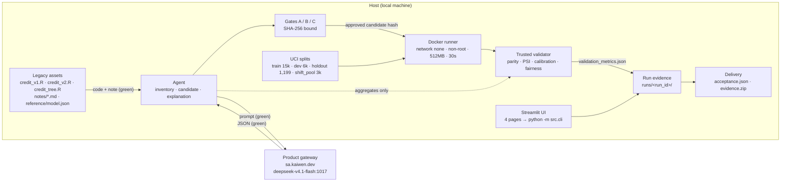

# Architecture (one page)

Deliverable for V3-03. The judge-facing diagram is [`architecture.svg`](architecture.svg)
(editable source) with a PNG copy at [`architecture.png`](architecture.png). This page
explains what the diagram shows and repeats the component list in text so it is readable
without an image viewer.

The diagram is drawn from the implemented system: every box corresponds to a module in
`src/`, a directory in `runs/<run_id>/`, or a gate in `docs/02_项目SOP.md` §7.

## Components

| Component | Where it lives | What it does |
| --- | --- | --- |
| Legacy assets | `legacy/`, `artifacts/reference/` | Three team-built R models (`glm`, `glm`, `rpart`), three deliberately stale notes, the exported R coefficients/medians. Read-only for the Agent. |
| Agent | `src/agent.py`, `src/provider.py` | Tool-calling stages: inventory extraction (3 models), Python candidate generation (≤2 repairs), report explanation. Max 8 model requests per round, recorded in `agent_audit_log.jsonl` and `provider/request_log.jsonl`. |
| Product gateway | `https://sa.kaiwen.dev/v1`, `openai_chat_completions` | Real LLM service. Model actually used: **`deepseek-v4.1-flash:1017`** (v1 candidate stage used `kimi-k2.7-code`). API key only in local environment variables. |
| Review gates | `src/review.py`, `src/cli.py approve` | Gate A = inventory canonical-JSON SHA-256; Gate B = candidate source SHA-256 (64 hex, before execution); Gate C = `report/review_manifest.json` SHA-256. Any `src/`/`config/`/candidate change invalidates earlier approvals. |
| Controlled Docker runner | `docker/`, `src/runner.py` | `--network none`, non-root 65532, read-only root and inputs, 512 MB, 1 CPU, 64 PID, 30 s timeout. Image `model-risk-factory-runner:v1` @ `sha256:00e23e46…`. |
| Trusted validator | `src/parity.py`, `src/validation.py`, `src/reference.py` | Separate host process; never imports the generated code. Compares candidate vs R baseline record by record, then computes performance/calibration/stability/fairness into `validation_metrics.json`. |
| Data splits | `data/`, `runs/<run_id>/data/` | 30,000 UCI rows (CC BY 4.0): train 15,000 / dev 6,000 / holdout 1,199 (seed 47) / shift_pool 3,000, 4,801 unused. Formal Holdout consumed once per campaign, recorded in `runs/holdout_consumption.jsonl` (not in Git). |
| Run evidence | `runs/<run_id>/` | Manifests, inventories, candidates, metrics, report, `review_log.json`, `command_log.jsonl`, failure drills. |
| Delivery / release check | `delivery/`, `src/release.py` | Whitelisted evidence ZIP + acceptance JSON; `release-check --tag <commit> --run-id <run>` returns `APPROVED`/`BLOCKED` with gaps. Requires a clean worktree at init, a matching commit, and 0 failed / 0 skipped tests in the isolated tag tree. |
| Streamlit UI | `app.py`, `src/ui_data.py`, `src/ui_charts.py` | Four read-only pages; every action shells out to `python -m src.cli`, so the UI cannot bypass a gate. |
| CLI spine | `src/cli.py` | Single entry point for every stage, gate, export and read-only check. |

## Data flow, and what the LLM does and does not see

1. `prepare` splits the raw data once (seed, hashes, tolerance frozen in `config/`).
2. `baseline` runs R inside the R image and exports coefficients, medians, feature order and predictions.
3. `extract-inventory` sends **only** the allowlisted R code, the simulated note and the JSON schema to the gateway → inventory JSON → deterministic validation (`src/inventory.py`) → Gate A.
4. `generate-candidate` sends the R code, the candidate contract, the approved inventory and the R model artifact → candidate source → Gate B.
5. `run-dev` / `candidate-fixtures` execute the candidate in the container; the trusted validator compares it with the R baseline.
6. `freeze` → one `accept` (Holdout consumed once) → `validation-metrics` (four metric families) → `agent-summary` (desensitised aggregates only) → `report` → Gate C → `approve-report`.
7. `failure-drills` → `export` (whitelisted ZIP + acceptance JSON) → `acceptance`.
8. `verify-context`, `compare-command-log`, `report-status`, `verify-holdout-ledger`, `release-check` are read-only and never write to a run directory.

| Crosses the LLM boundary (green) | Never leaves the host (red) |
| --- | --- |
| R code and the simulated legacy note | Row-level `train`/`dev`/`holdout`/`shift_pool` data |
| JSON schemas, frozen expectations, allowlisted paths | Labels and baseline (R) predictions |
| Aggregate diagnostics from development tests | Holdout inputs and answers |
| Desensitised aggregate metrics (parity, performance, stability, fairness summaries) | Test source, per-row parity diff files, API key |

## Editable source (Mermaid)

The SVG is hand-written and pixel-checked (no text overflow, no overlapping labels). If you
prefer to edit the graph as text, this Mermaid version carries the same components and flows:

Note on the picture: the green/red legend is a statement about data minimisation, not a
network diagram of the demo machine. The container has no network at all; only the Agent
process talks to the gateway.
